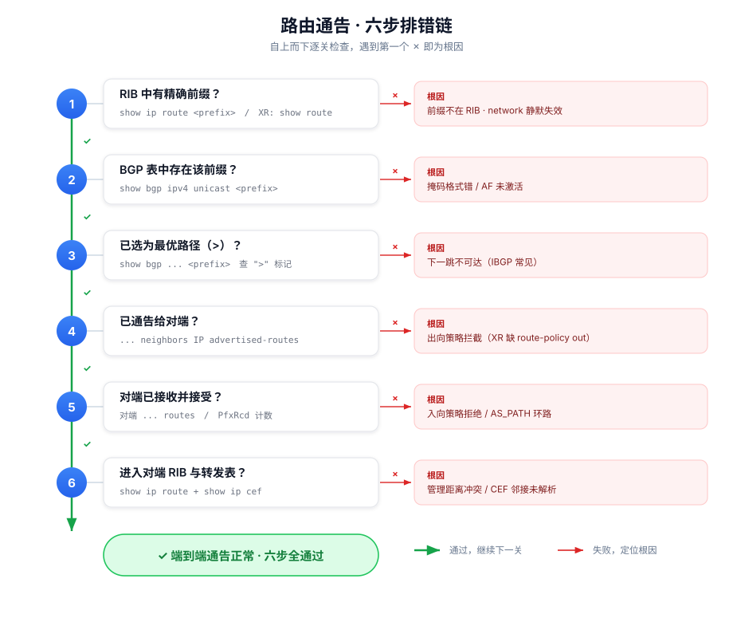
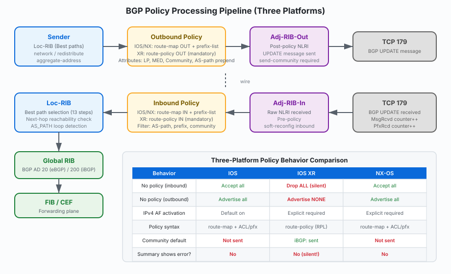
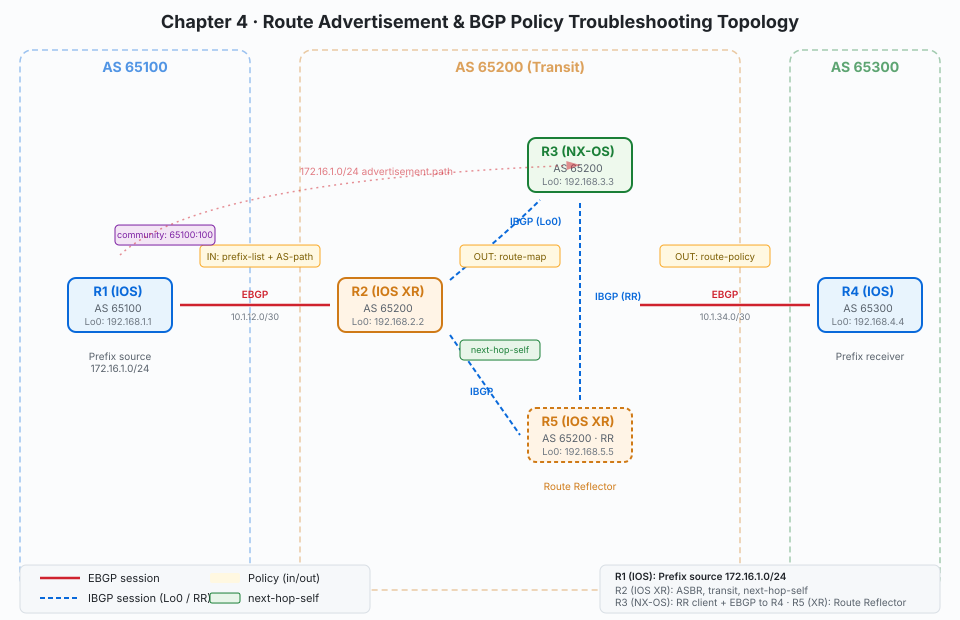

# 第 4 章 · 路由通告和 BGP 策略的排错

> **本章涵盖**：BGP 路由通告的六步排错链；前缀进入/离开 BGP 表的完整路径追踪；入向与出向策略的三平台差异；`network`/`redistribute`/`aggregate-address` 的排错；路径属性操纵（Weight、LOCAL_PREF、MED、AS_PATH prepend、Community）；条件通告与 RT 约束；策略验证工具（`soft-reconfiguration`、`advertised-routes`、`received-routes`）；IOS / IOS XR / NX-OS 命令对照；**六个三平台实战用例**。

---

## 4.1 路由通告的完整路径

第 3 章解决的是"邻居能不能起来"。本章解决的是"邻居起来了，路由为什么到不了对端"。这是 BGP 工单中数量最多的一类——**会话 Established，但前缀缺失或策略行为不符合预期**。

### 六步排错链

一条前缀从源端到接收端的 RIB，要经过六个关卡。排错就是**从源头逐关检查，找到第一个断点**：

| 步骤 | 检查点 | 命令 | 断点含义 |
|------|--------|------|----------|
| ① | RIB 有没有精确前缀？ | `show ip route` / XR `show route` / NX `show ip route` | 没有 → `network` 静默失效 |
| ② | BGP 表（Loc-RIB）有吗？ | `show bgp ipv4 unicast <prefix>` | 没有 → AF 未激活 / `network` 掩码写错 |
| ③ | 选中为最优路径（有 `>`）吗？ | `show bgp ipv4 unicast <prefix>` | 没有 → 下一跳不可达 / 策略拒绝 |
| ④ | 通告给对端了吗？ | `show bgp ... neighbors IP advertised-routes` | 没有 → 出向策略拒绝 / XR 缺 `route-policy out` |
| ⑤ | 对端接收并接受了吗？ | 对端 `show bgp ... routes` / `PfxRcd` | 没有 → 入向策略 / AS_PATH 环路 / XR 缺 `route-policy in` |
| ⑥ | 对端 RIB 和转发表里有吗？ | 对端 `show ip route` + `show ip cef` | 没有 → 管理距离冲突 / CEF 邻接未解析 |

> **排错铁律**：不要跳步。从①开始逐关验证，找到第一个"NO"，根因就在那里。跳到第④步发现 `advertised-routes` 为空，回头看①②③，可能只是 `network` 掩码写错。



---

## 4.2 BGP 策略处理管道

理解路由"为什么被丢了"，必须看清前缀在 BGP 内部经过的每一道关卡。下图展示了从发送端 Loc-RIB 到接收端 FIB 的完整管道：



### 三个关键关卡

| 关卡 | 位置 | 作用 | 排错关注点 |
|------|------|------|-----------|
| **出向策略** | Loc-RIB → Adj-RIB-Out | 决定"给谁、给什么、怎么改属性" | `advertised-routes` 为空 = 出向策略拒绝 |
| **Adj-RIB-In** | 对端收到 → 入向策略前 | 保存原始 NLRI | `received-routes` 有但 `routes` 没有 = 入向策略拒绝 |
| **入向策略** | Adj-RIB-In → Loc-RIB | 决定"收什么、怎么改属性" | XR 不配 `route-policy in` = 全部丢弃（静默） |

> **三平台默认行为差异是跨厂商对接的第一大坑**：IOS 默认全放行，NX-OS 需显式 `activate`，IOS XR **必须**关联 `route-policy` 否则入向全部丢弃、出向一条不发，且**无任何告警**。

---

## 4.3 `network` 命令的排错

### 4.3.1 `network` 不等于"启用接口上的 BGP"

`network` 的作用是**将 RIB 中精确匹配的前缀放入 BGP Loc-RIB**。它不创建路由，不启用接口，不做最长匹配。

| RIB 来源 | 下一跳 | Origin | Weight |
|----------|--------|--------|--------|
| 直连网络 | 0.0.0.0 | i (IGP) | 32,768 |
| 静态路由 | RIB 中的下一跳 | i (IGP) | 32,768 |
| IGP 重分布 | RIB 中的下一跳 | i (IGP) | 32,768 |

### 4.3.2 三平台 `network` 语法差异

```
! IOS：点分掩码
router bgp 65100
 address-family ipv4
  network 172.16.1.0 mask 255.255.255.0

! IOS XR：前缀/长度（CIDR）
router bgp 65200
 address-family ipv4 unicast
  network 172.16.1.0/24

! NX-OS：前缀/长度（CIDR）
router bgp 65300
  address-family ipv4 unicast
    network 172.16.1.0/24
```

> **最常见的错误**：在 IOS 上写了 `network 172.16.1.0/24`（CIDR 格式），IOS 不报错但**静默不生效**。反过来在 XR/NX-OS 上写了 `network 172.16.1.0 mask 255.255.255.0`，语法直接不识别。

### 4.3.3 `network` 不生效的四种根因

| 根因 | 现象 | 判据 |
|------|------|------|
| RIB 没有精确前缀 | BGP 表查不到 | `show ip route 172.16.1.0` 无精确匹配 |
| 掩码格式写错 | 同上 | IOS 用点分、XR/NX 用 CIDR |
| AF 未激活 | BGP 表为空 | `show bgp ... neighbors IP` 能力段无 `received` |
| 关了默认激活但没 `activate` | 同上 | `no bgp default ipv4-unicast` 后必须显式 `activate` |

### 4.3.4 静态兜底（Null0）

```
! IOS
ip route 172.16.1.0 255.255.255.0 Null0

! IOS XR
router static
 address-family ipv4 unicast
  172.16.1.0/24 Null0
 !
!

! NX-OS
ip route 172.16.1.0/24 Null0
```

> **副作用**：只要 Null0 路由存在，即使真实网络不可达，`/24` 仍会被通告。生产上应配合 `suppress-map` 或 IGP 跟踪。

---

## 4.4 `redistribute` 的排错

`redistribute` 将 IGP/静态/直连路由导入 BGP。与 `network` 不同，`redistribute` 不要求精确前缀匹配，但**需要路由映射控制**。

### 4.4.1 三平台 redistribute 写法

```
! IOS
router bgp 65100
 address-family ipv4
  redistribute ospf 1 route-map RM-OSPF-TO-BGP
  redistribute static
  redistribute connected

! IOS XR
router bgp 65200
 address-family ipv4 unicast
  redistribute ospf 1 route-policy RP-OSPF-TO-BGP
  redistribute connected route-policy RP-CONN

! NX-OS
router bgp 65300
  address-family ipv4 unicast
    redistribute ospf 1 route-map RM-OSPF-TO-BGP
    redistribute direct
```

### 4.4.2 redistribute 的三个陷阱

| 陷阱 | 现象 | 解决方案 |
|------|------|----------|
| **路由爆炸** | BGP 表从几百条暴增到数万条 | `route-map`/`route-policy` 只允许特定前缀 |
| **Origin = ?（Incomplete）** | 最优路径算法第 6 步中 IGP 优先于 Incomplete | 必要时用 `network` 替代 `redistribute` |
| **BGP→IGP→BGP 环路** | 从 BGP 学来的路由重分布进 IGP，又从 IGP 重分布回 BGP | IGP 侧过滤 BGP 路由（tag + route-map） |

> **生产铁律**：`redistribute` 必须带 `route-map`/`route-policy`，**永远不要裸重分布**——一次裸重分布可能导致整个 AS 的路由表爆炸。

---

## 4.5 `aggregate-address` 的排错

### 4.5.1 三平台语法

```
! IOS
aggregate-address 172.16.0.0 255.255.252.0 [summary-only] [as-set] [suppress-map] [advertise-map]

! IOS XR
aggregate-address 172.16.0.0/22 [summary-only] [route-policy] [as-set] [advertise-map]

! NX-OS
aggregate-address 172.16.0.0/22 [summary-only] [suppress-map] [as-set] [advertise-map]
```

### 4.5.2 聚合路由的关键属性

| 属性 | 含义 | 排错关注 |
|------|------|----------|
| 下一跳 `0.0.0.0`、`local` | 本机生成的聚合路由 | 正常，不是问题 |
| `atomic-aggregate` | 原始 AS_PATH/MED/Community 已丢失 | 告知下游"路径信息不完整" |
| AS_PATH 只有聚合者 ASN | 未加 `as-set` | 如需保留历史 ASN，加 `as-set` |
| `(aggregated by 65100 192.168.1.1)` | 聚合者 ASN 与 router-id | 验证聚合者身份 |

### 4.5.3 `summary-only` vs 不加

| 配置 | 行为 |
|------|------|
| 不加 `summary-only` | 聚合路由与明细**同时**通告，下游按最长匹配走明细 |
| 加 `summary-only` | 明细被抑制，只发聚合路由 |
| `suppress-map` | 选择性抑制特定明细，其余仍通告 |

> **常见错误**：加了 `aggregate-address` 但没加 `summary-only`，以为只发了汇总，实际上明细也在发——下游按最长匹配走明细，聚合路由形同虚设。

---

## 4.6 路径属性操纵与排错

### 4.6.1 最优路径算法回顾（与策略的关系）

BGP 13 步最优路径算法中，前几步与策略直接相关：

| 步骤 | 属性 | 类型 | 操纵场景 |
|------|------|------|----------|
| 1 | **Weight** | Cisco 私有，本地有效 | 影响本机出向选路 |
| 2 | **LOCAL_PREF** | 公认自决 | 影响 AS 内出向选路 |
| 5 | **AS_PATH** | 公认必遵 | prepend 增加路径长度，降低优先级 |
| 6 | **Origin** | 公认必遵 | IGP < EGP < Incomplete |
| 7 | **MED** | 可选非传递 | 影响相邻 AS 的入向选路（建议用） |

### 4.6.2 Weight（本地有效）

```
! IOS
neighbor 10.1.12.2 weight 200

! IOS XR
neighbor 10.1.12.1
 address-family ipv4 unicast
  route-policy RP-WEIGHT
   set weight 200
  end-policy

! NX-OS
neighbor 10.1.12.2
  address-family ipv4 unicast
    weight 200
```

> **Weight 不传递给任何邻居**——只影响本机 Loc-RIB 的最优路径选择。

### 4.6.3 LOCAL_PREF（AS 内传递）

```
! IOS
route-map RM-LP permit 10
 set local-preference 200
router bgp 65100
 address-family ipv4
  neighbor 10.1.12.2 route-map RM-LP in

! IOS XR
route-policy RP-LP
 set local-preference 200
end-policy
router bgp 65200
 neighbor 10.1.12.1
  address-family ipv4 unicast
   route-policy RP-LP in

! NX-OS
route-map RM-LP permit 10
 set local-preference 200
router bgp 65300
  neighbor 10.1.12.2
    address-family ipv4 unicast
      route-map RM-LP in
```

> **LOCAL_PREF 只在 IBGP 间传递**，EBGP 收到后不通告给 EBGP 对等体。默认值 100。

### 4.6.4 MED（跨 AS 建议）

```
! IOS
route-map RM-MED permit 10
 set metric 150
router bgp 65100
 address-family ipv4
  neighbor 10.1.12.2 route-map RM-MED out

! IOS XR
route-policy RP-MED
 set med 150
end-policy
router bgp 65200
 neighbor 10.1.12.1
  address-family ipv4 unicast
   route-policy RP-MED out

! NX-OS
route-map RM-MED permit 10
 set metric 150
router bgp 65300
  neighbor 10.1.12.2
    address-family ipv4 unicast
      route-map RM-MED out
```

> **MED 的两个坑**：① 默认只在**同一相邻 AS** 的多条路径间比较，跨 AS 比较需 `bgp always-compare-med`；② 默认 MED 为 0 的路由优先于未设 MED 的路由（除非 `bgp bestpath med missing-as-worst`）。

### 4.6.5 AS_PATH Prepend

```
! IOS
route-map RM-PREPEND permit 10
 set as-path prepend 65100 65100
router bgp 65100
 address-family ipv4
  neighbor 10.1.12.2 route-map RM-PREPEND out

! IOS XR
route-policy RP-PREPEND
 prepend as-path 65100 65100
end-policy

! NX-OS
route-map RM-PREPEND permit 10
 set as-path prepend 65100 65100
```

> **Prepend 的代价**：每 prepend 一个 ASN，AS_PATH 长度 +1，但**真实 AS_PATH 不变**。prepend 过多会让流量绕远路，通常 2-3 个足够。

### 4.6.6 Community（标记与策略触发）

```
! IOS
ip community-list standard CL-NOEXP permit no-export
route-map RM-MARK permit 10
 set community 65100:100 no-export additive
router bgp 65100
 address-family ipv4
  neighbor 10.1.12.2 send-community
  neighbor 10.1.12.2 route-map RM-MARK out

! IOS XR
community-set CS-NOEXP
 no-export
end-set
route-policy RP-MARK
 set community CS-NOEXP 65100:100 additive
end-policy
router bgp 65200
 neighbor 10.1.12.1
  address-family ipv4 unicast
   route-policy RP-MARK out
   send-community-ebgp

! NX-OS
ip community-list standard CL-NOEXP permit no-export
route-map RM-MARK permit 10
 set community 65100:100 no-export additive
router bgp 65300
  neighbor 10.1.12.2
    address-family ipv4 unicast
      send-community
      route-map RM-MARK out
```

**知名团体属性**：

| 团体 | 含义 |
|------|------|
| `no-export` | 不通告给 EBGP 对等体（可通告给联盟内子 AS） |
| `no-advertise` | 不通告给任何对等体 |
| `local-AS` | 不通告给联盟外（可通告给联盟内子 AS） |
| `internet` | 标准社区，无特殊行为 |

> **`additive` 关键字**：不加 `additive` 会**覆盖**原有团体属性。这是 Community 排错中最常见的"标记丢失"原因。

---

## 4.7 拓扑与设备角色



```
   AS 65100                    AS 65200 (Transit)                     AS 65300
   R1 (IOS)  ──EBGP──  R2 (IOS XR)  ──IBGP(Lo0)──  R3 (NX-OS)  ──EBGP──  R4 (IOS)
   Lo0: 192.168.1.1     Lo0: 192.168.2.2       Lo0: 192.168.3.3      Lo0: 192.168.4.4
   Gi0/1: 10.1.12.1/30  Gi0/0/0/1: 10.1.12.2/30 Eth1/1: 10.1.34.3/30  Gi0/1: 10.1.34.4/30
                        Gi0/0/0/2: 10.1.23.2/30 Eth1/2: 10.1.23.3/30
                        └────────────── IBGP(Lo0) ──────────────┘
                                          R5 (IOS XR) RR
                                          Lo0: 192.168.5.5
```

| 设备 | 平台 | AS | 角色 |
|------|------|-----|------|
| R1 | IOS | 65100 | 前缀源（172.16.1.0/24） |
| R2 | IOS XR | 65200 | ASBR/中转，EBGP + IBGP 汇合点 |
| R3 | NX-OS | 65200 | IBGP 对端（Lo0 建邻），EBGP 连 R4 |
| R4 | IOS | 65300 | 前缀接收方 |
| R5 | IOS XR | 65200 | 路由反射器（RR） |

---

## 4.8 三平台实战用例

> 输出为示意（字段顺序与真实设备一致）。三平台指 **IOS**、**IOS XR**、**NX-OS**。

### 用例 1：`network` 配了但 BGP 表里没有（掩码格式 + AF 激活）

**症状**：R1 配了 `network 172.16.1.0/24`，BGP 表里查不到。

**步骤 1 — 先确认 RIB 有没有精确前缀**

```
! R1 (IOS)
show ip route 172.16.1.0
172.16.1.0/24 is variably subnetted, 1 subnets, 1 masks
C    172.16.1.0/24 is directly connected, GigabitEthernet0/2
```

RIB 有精确前缀，问题不在 RIB。

**步骤 2 — 检查 `network` 语法格式**

```
! R1 (IOS) — 错误写法
router bgp 65100
 address-family ipv4
  network 172.16.1.0/24          ← IOS 不认 CIDR 格式，静默不生效
```

**根因**：IOS 的 `network` 命令只接受**点分掩码**（`mask 255.255.255.0`），写 CIDR 格式不报错但无效。

**步骤 3 — 修复（三平台正确写法）**

```
! R1 (IOS) — 正确写法
router bgp 65100
 address-family ipv4
  network 172.16.1.0 mask 255.255.255.0
```

```
! R2 (IOS XR) — CIDR 格式
router bgp 65200
 address-family ipv4 unicast
  network 172.16.1.0/24
```

```
! R3 (NX-OS) — CIDR 格式
router bgp 65300
  address-family ipv4 unicast
    network 172.16.1.0/24
```

**步骤 4 — 检查 AF 是否激活**

```
! R1 (IOS)：如果用了 no bgp default ipv4-unicast，必须显式 activate
show bgp ipv4 unicast neighbors 10.1.12.2 | include "Address family"
  Address family IPv4 Unicast: advertised and received    ← 正常
```

| 平台 | `network` 掩码格式 | AF 默认激活 |
|------|-------------------|------------|
| IOS | 点分掩码 `mask 255.255.255.0` | 是（除非 `no bgp default ipv4-unicast`） |
| IOS XR | CIDR `172.16.1.0/24` | 否，需显式 AF |
| NX-OS | CIDR `172.16.1.0/24` | 否，需显式 AF |

> **记忆法**：IOS = 老式，点分掩码；XR/NX = 新式，CIDR。混用就静默失效。

---

### 用例 2：路由在 BGP 表里但没有最优路径（下一跳不可达）

**症状**：R2 从 EBGP（R1）学到 `172.16.1.0/24`，最优路径已选中。R5（RR）从 IBGP 收到该路由但无 `>` 标记，不通告给 R3。

**步骤 1 — R5 上查看路由状态**

```
! R5 (IOS XR)
show bgp ipv4 unicast 172.16.1.0/24
BGP routing table entry for 172.16.1.0/24
  65100
    10.1.12.1 from 192.168.2.2 (192.168.2.2)
      Origin IGP, metric 0, localpref 100, valid, internal
                                                            ← 没有 best，没有 >
```

**步骤 2 — 检查下一跳可达性**

```
! R5 (IOS XR)
show route 10.1.12.1/32
% Network not found in table          ← 下一跳不可达
```

**判据**：R2 把 EBGP 学到的路由转给 IBGP 邻居时，**默认不修改下一跳**。R5 的下一跳指向 `10.1.12.1`（R1 的物理口地址），R5 没有到这个地址的路由 → BGP 下一跳可达性检查失败 → 不选最优 → 不通告。

**步骤 3 — 修复：在 R2 上配 `next-hop-self`**

```
! R2 (IOS XR) — 指向 R5 的 IBGP 邻居
router bgp 65200
 neighbor 192.168.5.5
  remote-as 65200
  update-source Loopback0
  address-family ipv4 unicast
   next-hop-self
   route-policy PASS-ALL in
   route-policy PASS-ALL out
  !
 !
!
```

```
! IOS 等价配置
router bgp 65200
 neighbor 192.168.5.5 remote-as 65200
 neighbor 192.168.5.5 update-source Loopback0
 neighbor 192.168.5.5 next-hop-self
 address-family ipv4
  neighbor 192.168.5.5 activate
```

```
! NX-OS 等价配置
router bgp 65200
  neighbor 192.168.5.5
    remote-as 65200
    update-source loopback0
    address-family ipv4 unicast
      next-hop-self
```

**步骤 4 — 验证**

```
! R5
show bgp ipv4 unicast 172.16.1.0/24
  65100
    192.168.2.2 from 192.168.2.2 (192.168.2.2)
      Origin IGP, metric 0, localpref 100, valid, internal, best
                                                            ↑ 下一跳改为 R2 Lo0，有 best
```

> **RR 不要配 `next-hop-self`**（除非 RR 在数据路径中）。带外 RR 改下一跳会把自己放到转发路径中，造成黑洞。

---

### 用例 3：R2 通告了路由但 R4 收不到（XR 缺出向 route-policy）

**症状**：R3 从 IBGP 收到 `172.16.1.0/24` 并通过 EBGP 通告给 R4。R4 的 `PfxRcd` 一直是 0。

**步骤 1 — 先看 R3 是否真的通告了**

```
! R3 (NX-OS)
show bgp ipv4 unicast neighbors 10.1.34.4 advertised-routes
! 输出为空 — R3 有路由但没发给 R4
```

**步骤 2 — R3 的 BGP 表有这条路由吗？**

```
! R3 (NX-OS)
show bgp ipv4 unicast 172.16.1.0/24
BGP routing table entry for 172.16.1.0/24, version 8
Paths: (1 available, best #1)
  65100
    192.168.2.2 from 192.168.2.2 (192.168.2.2)
      Origin IGP, metric 0, localpref 100, valid, internal, best
```

R3 有最优路径，但 `advertised-routes` 为空。

**步骤 3 — 检查 R3 的 AF 配置**

```
! R3 (NX-OS) — 检查邻居 AF 是否激活
show run bgp | include "neighbor 10.1.34.4"
neighbor 10.1.34.4
  remote-as 65300
  address-family ipv4 unicast     ← AF 激活了
```

NX-OS 侧 AF 激活正常。问题在**对端 R4**。

**步骤 4 — 在 R4 (IOS) 上检查**

```
! R4 (IOS)
show bgp ipv4 unicast summary
Neighbor        V    AS MsgRcvd MsgSent   TblVer  InQ OutQ Up/Down  State/PfxRcd
10.1.34.3       4 65200      42      40        0    0    0 00:15:02          0
```

会话正常，`PfxRcd = 0`。

```
show bgp ipv4 unicast neighbors 10.1.34.3 | include "Address family"
  Address family IPv4 Unicast: advertised and received
```

AF 协商正常。但 R3 没有发送任何 UPDATE（`MsgRcvd` 只有 KEEPALIVE 的量）。

**步骤 5 — 回到 R3 确认是否有出向策略阻拦**

```
! R3 (NX-OS)
show bgp ipv4 unicast neighbors 10.1.34.4 | include "policy|route-map"
  Inbound route-map: (not configured)
  Outbound route-map: (not configured)     ← NX-OS 无策略默认放行
```

NX-OS 没有出向策略阻拦。R3 有路由、AF 激活、无策略阻拦——但就是不发。

**步骤 6 — 检查 R3 从 IBGP 学到的路由是否可以通告给 EBGP**

```
! R3 (NX-OS) — 看 R3 这条路由的来源
show bgp ipv4 unicast 172.16.1.0/24
  65100
    192.168.2.2 from 192.168.2.2 (192.168.2.2)
      Origin IGP, metric 0, localpref 100, valid, internal, best
```

`internal` = 从 IBGP 学到。IBGP→EBGP 通告规则：**可以**从 IBGP 学到的最优路径通告给 EBGP 对等体。但 R3 的下一跳是 `192.168.2.2`（R2 的 Lo0），R4 不可达。

**步骤 7 — R3 需要配 next-hop-self（面向 EBGP 邻居）**

```
! R3 (NX-OS)
router bgp 65200
  neighbor 10.1.34.4
    remote-as 65300
    address-family ipv4 unicast
      next-hop-self
```

> **IBGP→EBGP 通告时，EBGP 会自动修改下一跳为自己的地址**。但 NX-OS 在某些版本中，如果路由来自 IBGP 且下一跳不是直连，需要在 EBGP 邻居上显式配 `next-hop-self` 确保下一跳改为自己的接口地址。

**步骤 8 — 验证**

```
! R4 (IOS)
show bgp ipv4 unicast summary
10.1.34.3       4 65200      48      46        1    0    0 00:00:15          1
                                                                          ↑ 收到 1 条
show bgp ipv4 unicast 172.16.1.0/24
  65100
    10.1.34.3 from 10.1.34.3 (192.168.3.3)
      Origin IGP, metric 0, localpref 100, valid, external, best
```

---

### 用例 4：出向策略配了 `route-map deny` 导致一条路由都不发

**症状**：R2 有一组前缀要通告给 R1，配了 `route-map` 做过滤，但 R1 一条都收不到。

**步骤 1 — R2 检查 `advertised-routes`**

```
! R2 (IOS XR)
show bgp ipv4 unicast neighbors 10.1.12.1 advertised-routes
% No prefixes advertised                    ← 一条都没发
```

**步骤 2 — 检查出向策略**

```
! R2 (IOS XR)
route-policy FILTER-OUT
  if destination in (172.16.0.0/16 le 24) then
    pass
  else
    drop
  endif
end-policy
```

**步骤 3 — 检查 R2 的 BGP 表中前缀掩码**

```
! R2 (IOS XR)
show bgp ipv4 unicast | include "172.16"
*> 172.16.1.0/24      10.1.12.1        0     0 65100 i
*> 172.16.2.0/25      10.1.12.1        0     0 65100 i
*> 172.16.3.0/24      10.1.12.1        0     0 65100 i
```

**根因**：`172.16.2.0/25` 的掩码是 `/25`，而策略 `172.16.0.0/16 le 24` 只匹配 `/16` 到 `/24`。`/25` 被 `drop` 了。但 `172.16.1.0/24` 和 `172.16.3.0/24` 应该匹配——问题在哪？

**步骤 4 — 检查 route-policy 是否真的关联到了邻居**

```
! R2 (IOS XR)
show running-config router bgp 65200 neighbor 10.1.12.1
neighbor 10.1.12.1
  remote-as 65100
  address-family ipv4 unicast
   route-policy FILTER-OUT in             ← 只配了 in，没有 out！
  !
```

**根因**：`route-policy FILTER-OUT` 被关联到了 `in` 方向，没有关联 `out`。XR **不关联 `route-policy out` 就不通告任何 NLRI**——这是 XR 的默认行为，不是 Bug。

**步骤 5 — 修复**

```
! R2 (IOS XR)
router bgp 65200
 neighbor 10.1.12.1
  address-family ipv4 unicast
   route-policy FILTER-OUT in
   route-policy FILTER-OUT out            ← 补上出向策略
  !
 !
!
```

**步骤 6 — 验证**

```
! R2 (IOS XR)
show bgp ipv4 unicast neighbors 10.1.12.1 advertised-routes
   Network            Next Hop        Metric LocPrf Weight Path
*> 172.16.1.0/24      10.1.12.1        0     0 65100 i
*> 172.16.3.0/24      10.1.12.1        0     0 65100 i
                                              ↑ /25 被正确过滤，其余正常通告
```

> **XR 的静默陷阱是跨厂商排错第一大坑**：会话正常、路由在表里、日志干净——但就是一条不发。先查 `route-policy out` 有没有配。

---

### 用例 5：入向策略把所有路由都拒了（`received-routes` vs `routes`）

**症状**：R4 从 R3 收到路由，但 BGP 表为空。`PfxRcd` 显示收到前缀，但 `show bgp` 查不到。

**步骤 1 — summary 显示收到了前缀**

```
! R4 (IOS)
show bgp ipv4 unicast summary
Neighbor        V    AS MsgRcvd MsgSent   TblVer  InQ OutQ Up/Down  State/PfxRcd
10.1.34.3       4 65200     128     120        0    0    0 00:20:15          3
```

`PfxRcd = 3`，说明 R3 发了 3 条。但 BGP 表为空？

**步骤 2 — 检查入向策略**

```
! R4 (IOS)
show bgp ipv4 unicast neighbors 10.1.34.3 | include "Prefix activity|accepted|filtered|route-map"
  Prefix activity:               ----       ----
    Prefixes Current:               0          0
    Prefixes Total:                 3          3
  Local Policy Denied Prefixes:    -----      -----
    inbound route-map:               3          0    ← 3 条全被 route-map 拒了
  Inbound route-map: RM-IN
```

**判据**：`Prefixes Total` = 3（收到了），`inbound route-map` denied = 3（全拒了）。

**步骤 3 — 查看入向 route-map**

```
! R4 (IOS)
show run | section route-map RM-IN
route-map RM-IN permit 10
 match ip address prefix-list PL-IN
!
ip prefix-list PL-IN seq 5 permit 172.16.1.0/24
```

**根因**：`prefix-list PL-IN` 只允许 `172.16.1.0/24`，但 R3 发来的是 `172.16.1.0/24`、`172.16.2.0/24`、`172.16.3.0/24`。后两条被拒了。而 `172.16.1.0/24` 为什么也被拒？

**步骤 4 — 用 `received-routes` 看原始数据**

```
! R4 (IOS) — 需要配 soft-reconfiguration inbound
! 先配
router bgp 65300
 address-family ipv4
  neighbor 10.1.34.3 soft-reconfiguration inbound

! 再软重置
clear ip bgp 10.1.34.3 soft in

! 看收到的原始路由
show bgp ipv4 unicast neighbors 10.1.34.3 received-routes
   Network            Next Hop        Metric LocPrf Weight Path
*  172.16.1.0/24      10.1.34.3            0             0 65200 i
*  172.16.2.0/24      10.1.34.3            0             0 65200 i
*  172.16.3.0/24      10.1.34.3            0             0 65200 i

! 对比 accepted routes
show bgp ipv4 unicast neighbors 10.1.34.3 routes
（空 — 全被拒了）
```

> **判据**：`received-routes` 有、`routes` 没有 = 入向策略拒绝了所有路由。

**步骤 5 — 修复 prefix-list**

```
! R4 (IOS)
ip prefix-list PL-IN seq 5 permit 172.16.1.0/24
ip prefix-list PL-IN seq 10 permit 172.16.2.0/24
ip prefix-list PL-IN seq 15 permit 172.16.3.0/24
! 或用范围：
ip prefix-list PL-IN seq 5 permit 172.16.0.0/16 le 24

! 软重置后验证
clear ip bgp 10.1.34.3 soft in
show bgp ipv4 unicast neighbors 10.1.34.3 routes
   Network            Next Hop        Metric LocPrf Weight Path
*> 172.16.1.0/24      10.1.34.3            0             0 65200 i
*> 172.16.2.0/24      10.1.34.3            0             0 65200 i
*> 172.16.3.0/24      10.1.34.3            0             0 65200 i
```

**三平台验证入向接收的命令**

| 用途 | IOS | IOS XR | NX-OS |
|------|-----|--------|-------|
| 收到的原始路由 | `received-routes` | `received-routes`（不需 soft-reconfig） | `received-routes` |
| 被接受的路由 | `routes` | `routes` | `routes` |
| 被拒的计数 | `show bgp neighbors IP` 的 `Local Policy Denied` | `show bgp neighbors IP` 的 `Rejected` | `show bgp neighbors IP` 的 `filter` |
| 启用 received-routes | `neighbor IP soft-reconfiguration inbound` | 默认可用 | `neighbor IP soft-reconfiguration inbound` |

---

### 用例 6：Community 标记丢失（`send-community` + `additive`）

**症状**：R1 给 `172.16.1.0/24` 打了 `no-export` 团体标记，R2 收到后看不到 Community 属性。

**步骤 1 — R2 检查是否收到 Community**

```
! R2 (IOS XR)
show bgp ipv4 unicast 172.16.1.0/24 | include Community
（无输出 — Community 行完全缺失）
```

**步骤 2 — R1 确认本地有标记**

```
! R1 (IOS)
show bgp ipv4 unicast 172.16.1.0/24 | include Community
      Community: no-export               ← 本地有
```

**根因**：BGP 默认**不向对等体发送 Community 属性**。必须显式配 `send-community`。

**步骤 3 — R1 配置 send-community（三平台）**

```
! R1 (IOS)
router bgp 65100
 address-family ipv4
  neighbor 10.1.12.2 send-community
  neighbor 10.1.12.2 route-map RM-MARK out

route-map RM-MARK permit 10
 set community no-export 65100:100 additive
```

```
! R2 (IOS XR) — 如果 R2 也要转发给 R5，R2 侧也要开
router bgp 65200
 neighbor 192.168.5.5
  address-family ipv4 unicast
   send-community-ebgp              ← XR 的发送开关
   route-policy PASS-ALL out
  !
```

```
! R3 (NX-OS)
router bgp 65200
  neighbor 10.1.34.4
    address-family ipv4 unicast
      send-community
```

**步骤 4 — 验证**

```
! R2 (IOS XR)
show bgp ipv4 unicast 172.16.1.0/24 | include Community
      Community: no-export 65100:100       ← Community 到了
```

**步骤 5 — 验证 `no-export` 的行为**

```
! R2 想把这条路由通告给 R5 (IBGP) — 应该可以
show bgp ipv4 unicast neighbors 192.168.5.5 advertised-routes
   Network            Next Hop        Metric LocPrf Weight Path
*> 172.16.1.0/24      10.1.12.1            0    100     0 65100 i
! 但 R2 想通告给 EBGP 邻居时 — 被 no-export 拦截
show bgp ipv4 unicast neighbors 10.1.34.4 advertised-routes
（空 — no-export 生效，不通告给 EBGP）
```

**Community 排错的三个陷阱**

| 陷阱 | 现象 | 修正 |
|------|------|------|
| 没配 `send-community` | 对端看不到任何 Community | 在邻居下显式配 `send-community`（按邻居） |
| 没加 `additive` | 新标记**覆盖**了原有团体 | `set community X additive` |
| EBGP 和 IBGP 分别开 | EBGP 上有，IBGP 上没有 | `send-community` 是**按邻居**配置，要分别开 |

> **XR 特别提醒**：XR 的发送开关叫 `send-community-ebgp`（EBGP）和 `send-community-ibgp`（IBGP），默认 IBGP 通告、EBGP 不通告。

---

### 用例与知识点对应表

| 用例 | 验证的基础知识 | 章节 |
|------|--------------|------|
| 1. `network` 不生效 | `network` 语法差异、AF 激活 | 4.3 |
| 2. 下一跳不可达 | IBGP 下一跳规则、`next-hop-self` | 4.6 / 4.2 |
| 3. IBGP→EBGP 通告失败 | 通告规则、下一跳、AF 激活 | 4.2 / 4.5 |
| 4. 出向策略全拒 | XR `route-policy out` 必须配 | 4.2 / 4.6 |
| 5. 入向策略全拒 | `received-routes` vs `routes`、`soft-reconfiguration` | 4.2 / 4.6 |
| 6. Community 丢失 | `send-community`、`additive`、`no-export` | 4.6.6 |

### 六个用例的共同骨架

```
1. RIB 有没有？ → show ip route / show route
2. BGP 表有没有？ → show bgp ipv4 unicast <prefix>
3. 最优路径选了吗？ → 有 > 标记？
4. 通告了吗？ → advertised-routes 有没有？
5. 收到了吗？ → PfxRcd 是几？routes 有没有？
6. 进 RIB 了吗？ → show ip route + show ip cef
```

> 第 3 章解决"邻居起不来"，第 4 章解决"邻居起来了路由不通"。六步排错链是本章的全部精髓——从源头到终点逐关检查，找到第一个断点。

---

## 关键命令速查表

| 命令 | 用途 |
|------|------|
| `show ip route <prefix>` / XR `show route <prefix>/len` | 验证 RIB 是否有精确前缀 |
| `show bgp ipv4 unicast <prefix>` | 验证 BGP 表是否有前缀及最优路径 |
| `show bgp ipv4 unicast` | 查看 BGP 表全貌 |
| `show bgp ipv4 unicast neighbors IP advertised-routes` | 验证出向通告了什么 |
| `show bgp ipv4 unicast neighbors IP routes` | 验证对端被接受的路由 |
| `show bgp ipv4 unicast neighbors IP received-routes` | 查看未经入向策略的原始路由 |
| `clear ip bgp IP soft in/out` | 软重置，不重建 TCP |
| `clear ip bgp * soft in` | 全部软重置入向 |
| `show bgp ipv4 unicast neighbors IP` | 查看 Accepted/Rejected 计数 |
| `show bgp ipv4 unicast <prefix>` | 查看前缀的路径属性（Community、LP、MED 等） |

---

## 三平台差异速查

| 特性 | IOS | IOS XR | NX-OS |
|------|-----|--------|-------|
| `network` 掩码格式 | 点分掩码 | CIDR | CIDR |
| IPv4 AF 默认激活 | 是 | 否 | 否 |
| 无策略入向行为 | 全接受 | **全丢弃（静默）** | 全接受 |
| 无策略出向行为 | 全通告 | **全不通告（静默）** | 全通告 |
| 策略语法 | route-map + prefix-list | route-policy (RPL) | route-map + prefix-list |
| Community 默认发送 | 否 | IBGP 发送、EBGP 否 | 否 |
| Community 发送开关 | `send-community` | `send-community-ebgp` | `send-community` |
| `received-routes` 需要 | `soft-reconfiguration inbound` | 默认可用 | `soft-reconfiguration inbound` |
| 被拒计数字段 | `Local Policy Denied Prefixes` | `Prefixes Rejected by inbound policy` | `filter` 计数 |
| `next-hop-self` 位置 | AF 下 | AF 下 | AF 下 |
| 聚合命令掩码 | 点分掩码 | CIDR | CIDR |
| `redistribute connected` | `connected` | `connected` | `direct` |

---

## 本章核心要点

1. **六步排错链**：RIB → BGP 表 → 最优路径 → 通告 → 接收 → RIB+CEF，从源头逐关检查
2. **`network` 不创建路由**，只把 RIB 中精确匹配的前缀搬进 BGP；掩码格式三平台不同（IOS 点分、XR/NX CIDR）
3. **`redistribute` 必须带 route-map**，裸重分布会导致路由爆炸
4. **`aggregate-address` 不加 `summary-only` 时明细同时通告**，下游按最长匹配走明细
5. **下一跳不可达是最常见的 IBGP 排错问题**，用 `next-hop-self` 解决
6. **XR 不关联 `route-policy` 就静默丢弃入向、不通告出向**——跨厂商第一坑
7. **`received-routes` 有、`routes` 没有 = 入向策略拒绝了**——这是区分"没收到"和"收到被拒"的关键
8. **`send-community` 是按邻居配置的**，EBGP 和 IBGP 要分别开
9. **`additive` 关键字**不加会覆盖原有 Community——标记丢失的第一原因
10. **Weight 本地有效**，LOCAL_PREF 只在 IBGP 间传递，MED 跨 AS 建议
11. **AS_PATH prepend** 增加路径长度但不改变真实路径，2-3 个足够
12. **策略排错的终极工具**：`soft-reconfiguration inbound` + `received-routes`——看到未经策略的原始数据

---

[← 第 3 章 · 排查对等体问题](chapter-03-troubleshooting-peering.md) | [← 返回首页](../) | [English version](en/chapter-04-route-advertising-and-policy.md) | 第 5 章 · BGP 收敛（待精读）
