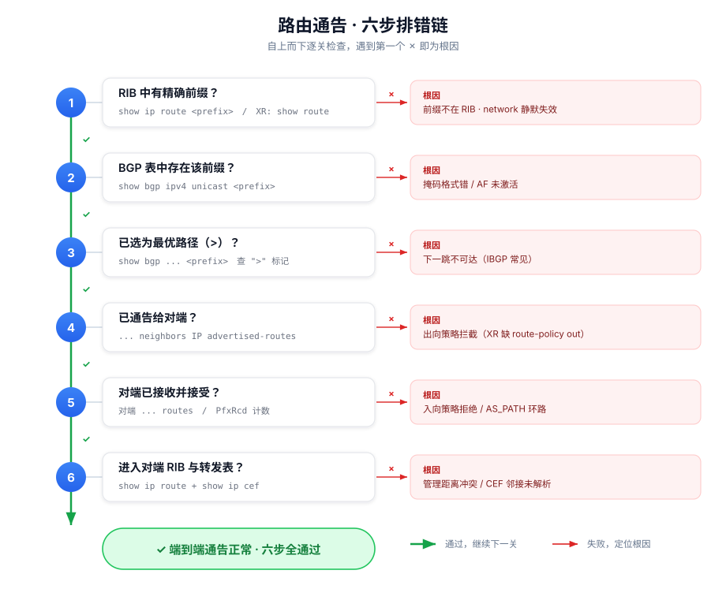
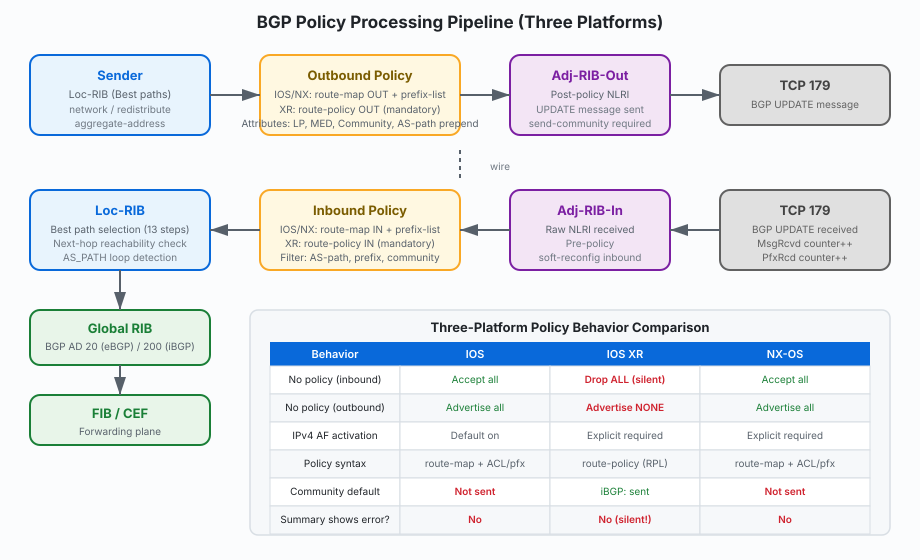
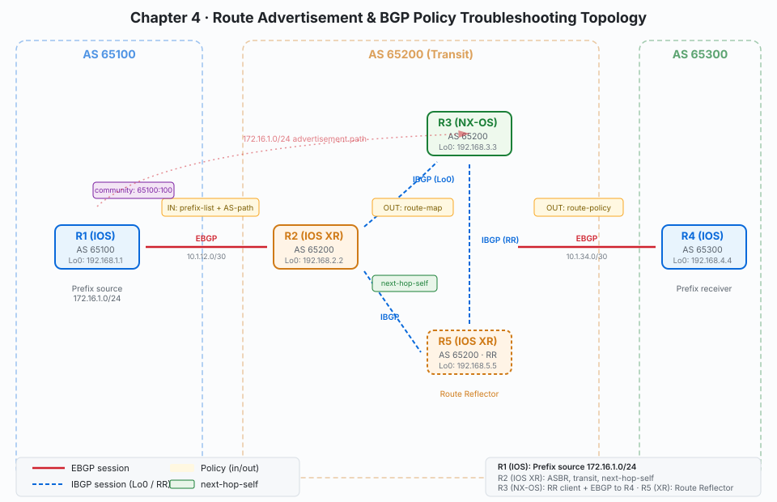

# Chapter 4 · Troubleshooting Route Advertisement and BGP Policies

> **This chapter covers**: The six-step route advertisement troubleshooting chain; complete path tracing of prefixes entering and leaving the BGP table; three-platform differences in inbound and outbound policies; troubleshooting `network`/`redistribute`/`aggregate-address`; path attribute manipulation (Weight, LOCAL_PREF, MED, AS_PATH prepend, Community); conditional advertisement and RT constraints; policy verification tools (`soft-reconfiguration`, `advertised-routes`, `received-routes`); IOS / IOS XR / NX-OS command comparison; **six cross-platform practical use cases**.

---

## 4.1 The Complete Path of Route Advertisement

Chapter 3 addressed "can the neighbor come up?" This chapter addresses "the neighbor is up, but why doesn't the prefix reach the other end?" This is the most common category of BGP tickets — **the session is Established, but prefixes are missing or policy behavior doesn't match expectations**.

### The Six-Step Troubleshooting Chain

A prefix travels through six checkpoints from the source to the receiver's RIB. Troubleshooting means **checking each checkpoint sequentially from the source, finding the first break**:

| Step | Checkpoint | Command | Break meaning |
|------|-----------|---------|---------------|
| ① | Does the RIB have the exact prefix? | `show ip route` / XR `show route` / NX `show ip route` | No → `network` silently fails |
| ② | Is it in the BGP table (Loc-RIB)? | `show bgp ipv4 unicast <prefix>` | No → AF not activated / wrong `network` mask |
| ③ | Selected as best path (has `>`)? | `show bgp ipv4 unicast <prefix>` | No → next-hop unreachable / policy denied |
| ④ | Advertised to the peer? | `show bgp ... neighbors IP advertised-routes` | No → outbound policy denied / XR missing `route-policy out` |
| ⑤ | Received and accepted by peer? | Peer: `show bgp ... routes` / `PfxRcd` | No → inbound policy / AS_PATH loop / XR missing `route-policy in` |
| ⑥ | In peer's RIB and forwarding? | Peer: `show ip route` + `show ip cef` | No → admin distance conflict / CEF adjacency unresolved |

> **Troubleshooting rule**: Never skip steps. Start from ① and verify each checkpoint. Find the first "NO" — that's where the root cause is. Jumping to step ④ and finding `advertised-routes` empty, only to backtrack through ①②③, might reveal it's just a `network` mask typo.



---

## 4.2 The BGP Policy Processing Pipeline

Understanding "why a prefix was dropped" requires seeing every checkpoint a prefix passes through inside BGP. The diagram below shows the complete pipeline from the sender's Loc-RIB to the receiver's FIB:



### Three Key Checkpoints

| Checkpoint | Location | Function | Troubleshooting focus |
|-----------|----------|----------|----------------------|
| **Outbound Policy** | Loc-RIB → Adj-RIB-Out | Decides "to whom, what, and how to modify attributes" | `advertised-routes` empty = outbound policy denied |
| **Adj-RIB-In** | Peer receives → before inbound policy | Stores raw NLRI | `received-routes` has entries but `routes` doesn't = inbound policy denied |
| **Inbound Policy** | Adj-RIB-In → Loc-RIB | Decides "what to accept and how to modify attributes" | XR without `route-policy in` = drops everything (silently) |

> **The three-platform default behavior difference is the #1 pitfall in cross-vendor integration**: IOS defaults to accept-all, NX-OS requires explicit `activate`, and IOS XR **must** have a `route-policy` associated or it drops all inbound NLRI and advertises nothing outbound — **with no warning whatsoever**.

---

## 4.3 Troubleshooting the `network` Command

### 4.3.1 `network` ≠ "Enable BGP on an Interface"

The `network` command's job is to **place an exact-match prefix from the RIB into the BGP Loc-RIB**. It does not create routes, enable interfaces, or perform longest-prefix matching.

| RIB Source | Next Hop | Origin | Weight |
|-----------|----------|--------|--------|
| Directly connected | 0.0.0.0 | i (IGP) | 32,768 |
| Static route | RIB next hop | i (IGP) | 32,768 |
| IGP redistribution | RIB next hop | i (IGP) | 32,768 |

### 4.3.2 Three-Platform `network` Syntax Differences

```
! IOS: dotted mask
router bgp 65100
 address-family ipv4
  network 172.16.1.0 mask 255.255.255.0

! IOS XR: prefix/length (CIDR)
router bgp 65200
 address-family ipv4 unicast
  network 172.16.1.0/24

! NX-OS: prefix/length (CIDR)
router bgp 65300
  address-family ipv4 unicast
    network 172.16.1.0/24
```

> **Most common mistake**: Writing `network 172.16.1.0/24` (CIDR) on IOS — it doesn't error but **silently does nothing**. Conversely, writing `network 172.16.1.0 mask 255.255.255.0` on XR/NX-OS is a syntax error.

### 4.3.3 Four Root Causes for `network` Not Working

| Root Cause | Symptom | Evidence |
|-----------|---------|----------|
| RIB lacks exact prefix | BGP table shows nothing | `show ip route 172.16.1.0` has no exact match |
| Wrong mask format | Same | IOS uses dotted, XR/NX uses CIDR |
| AF not activated | BGP table empty | `show bgp ... neighbors IP` capability shows no `received` |
| `no bgp default ipv4-unicast` without `activate` | Same | Must explicitly `activate` after disabling default |

### 4.3.4 Static Null0 Backup

```
! IOS
ip route 172.16.1.0 255.255.255.0 Null0

! IOS XR
router static
 address-family ipv4 unicast
  172.16.1.0/24 Null0
 !
!

! NX-OS
ip route 172.16.1.0/24 Null0
```

> **Side effect**: As long as the Null0 route exists, the `/24` will be advertised even if the real network is unreachable. In production, use `suppress-map` or IGP tracking.

---

## 4.4 Troubleshooting `redistribute`

`redistribute` imports IGP/static/connected routes into BGP. Unlike `network`, it doesn't require exact prefix matching, but **requires route-map control**.

### 4.4.1 Three-Platform redistribute Syntax

```
! IOS
router bgp 65100
 address-family ipv4
  redistribute ospf 1 route-map RM-OSPF-TO-BGP
  redistribute static
  redistribute connected

! IOS XR
router bgp 65200
 address-family ipv4 unicast
  redistribute ospf 1 route-policy RP-OSPF-TO-BGP
  redistribute connected route-policy RP-CONN

! NX-OS
router bgp 65300
  address-family ipv4 unicast
    redistribute ospf 1 route-map RM-OSPF-TO-BGP
    redistribute direct
```

### 4.4.2 Three Pitfalls of redistribute

| Pitfall | Symptom | Solution |
|---------|---------|----------|
| **Route explosion** | BGP table jumps from hundreds to tens of thousands | `route-map`/`route-policy` to allow only specific prefixes |
| **Origin = ? (Incomplete)** | In best-path step 6, IGP beats Incomplete | Use `network` instead of `redistribute` when possible |
| **BGP→IGP→BGP loop** | Routes learned from BGP redistributed into IGP, then back into BGP | Filter BGP routes on the IGP side (tag + route-map) |

> **Production rule**: `redistribute` must always have a `route-map`/`route-policy` — **never do bare redistribution**. One bare redistribution can cause the entire AS's routing table to explode.

---

## 4.5 Troubleshooting `aggregate-address`

### 4.5.1 Three-Platform Syntax

```
! IOS
aggregate-address 172.16.0.0 255.255.252.0 [summary-only] [as-set] [suppress-map] [advertise-map]

! IOS XR
aggregate-address 172.16.0.0/22 [summary-only] [route-policy] [as-set] [advertise-map]

! NX-OS
aggregate-address 172.16.0.0/22 [summary-only] [suppress-map] [as-set] [advertise-map]
```

### 4.5.2 Key Attributes of Aggregate Routes

| Attribute | Meaning | Troubleshooting Focus |
|-----------|---------|----------------------|
| Next hop `0.0.0.0`, `local` | Locally generated aggregate | Normal, not a problem |
| `atomic-aggregate` | Original AS_PATH/MED/Community lost | Notifies downstream "path info incomplete" |
| AS_PATH shows only aggregator's ASN | `as-set` not used | Add `as-set` to preserve historical ASNs |
| `(aggregated by 65100 192.168.1.1)` | Aggregator ASN and router-id | Verify aggregator identity |

### 4.5.3 `summary-only` vs Not

| Config | Behavior |
|--------|----------|
| Without `summary-only` | Aggregate and specifics **both** advertised; downstream uses longest match for specifics |
| With `summary-only` | Specifics suppressed; only aggregate sent |
| `suppress-map` | Selectively suppress specific prefixes; rest still advertised |

> **Common mistake**: Adding `aggregate-address` without `summary-only`, thinking only the summary is sent — specifics are also going out, and downstream follows the longest match, rendering the aggregate useless.

---

## 4.6 Path Attribute Manipulation and Troubleshooting

### 4.6.1 Best-Path Algorithm Review (Policy Relationship)

Several early steps in the 13-step best-path algorithm directly relate to policy:

| Step | Attribute | Type | Manipulation Scenario |
|------|-----------|------|----------------------|
| 1 | **Weight** | Cisco proprietary, local only | Influences local outbound path selection |
| 2 | **LOCAL_PREF** | Well-known discretionary | Influences AS-internal outbound selection |
| 5 | **AS_PATH** | Well-known mandatory | Prepend increases path length, lowers preference |
| 6 | **Origin** | Well-known mandatory | IGP < EGP < Incomplete |
| 7 | **MED** | Optional non-transitive | Influences adjacent AS's inbound selection (recommended) |

### 4.6.2 Weight (Local Only)

```
! IOS
neighbor 10.1.12.2 weight 200

! IOS XR
neighbor 10.1.12.1
 address-family ipv4 unicast
  route-policy RP-WEIGHT
   set weight 200
  end-policy

! NX-OS
neighbor 10.1.12.2
  address-family ipv4 unicast
    weight 200
```

> **Weight is not propagated to any neighbor** — it only affects the local Loc-RIB best-path selection.

### 4.6.3 LOCAL_PREF (Propagated Within AS)

```
! IOS
route-map RM-LP permit 10
 set local-preference 200
router bgp 65100
 address-family ipv4
  neighbor 10.1.12.2 route-map RM-LP in

! IOS XR
route-policy RP-LP
 set local-preference 200
end-policy
router bgp 65200
 neighbor 10.1.12.1
  address-family ipv4 unicast
   route-policy RP-LP in

! NX-OS
route-map RM-LP permit 10
 set local-preference 200
router bgp 65300
  neighbor 10.1.12.2
    address-family ipv4 unicast
      route-map RM-LP in
```

> **LOCAL_PREF propagates only among IBGP peers** — not advertised to EBGP peers. Default value is 100.

### 4.6.4 MED (Cross-AS Suggestion)

```
! IOS
route-map RM-MED permit 10
 set metric 150
router bgp 65100
 address-family ipv4
  neighbor 10.1.12.2 route-map RM-MED out

! IOS XR
route-policy RP-MED
 set med 150
end-policy
router bgp 65200
 neighbor 10.1.12.1
  address-family ipv4 unicast
   route-policy RP-MED out

! NX-OS
route-map RM-MED permit 10
 set metric 150
router bgp 65300
  neighbor 10.1.12.2
    address-family ipv4 unicast
      route-map RM-MED out
```

> **Two MED pitfalls**: ① By default, MED is only compared between paths from the **same neighboring AS**; cross-AS comparison requires `bgp always-compare-med`; ② A route with MED=0 is preferred over one without MED set (unless `bgp bestpath med missing-as-worst`).

### 4.6.5 AS_PATH Prepend

```
! IOS
route-map RM-PREPEND permit 10
 set as-path prepend 65100 65100
router bgp 65100
 address-family ipv4
  neighbor 10.1.12.2 route-map RM-PREPEND out

! IOS XR
route-policy RP-PREPEND
 prepend as-path 65100 65100
end-policy

! NX-OS
route-map RM-PREPEND permit 10
 set as-path prepend 65100 65100
```

> **Cost of prepend**: Each prepended ASN increases AS_PATH length by 1, but the **real AS_PATH doesn't change**. Excessive prepending makes traffic take longer paths; 2-3 is usually sufficient.

### 4.6.6 Community (Tagging and Policy Triggers)

```
! IOS
ip community-list standard CL-NOEXP permit no-export
route-map RM-MARK permit 10
 set community 65100:100 no-export additive
router bgp 65100
 address-family ipv4
  neighbor 10.1.12.2 send-community
  neighbor 10.1.12.2 route-map RM-MARK out

! IOS XR
community-set CS-NOEXP
 no-export
end-set
route-policy RP-MARK
 set community CS-NOEXP 65100:100 additive
end-policy
router bgp 65200
 neighbor 10.1.12.1
  address-family ipv4 unicast
   route-policy RP-MARK out
   send-community-ebgp

! NX-OS
ip community-list standard CL-NOEXP permit no-export
route-map RM-MARK permit 10
 set community 65100:100 no-export additive
router bgp 65300
  neighbor 10.1.12.2
    address-family ipv4 unicast
      send-community
      route-map RM-MARK out
```

**Well-Known Communities**:

| Community | Meaning |
|-----------|---------|
| `no-export` | Do not advertise to EBGP peers (can advertise to confederation sub-AS) |
| `no-advertise` | Do not advertise to any peer |
| `local-AS` | Do not advertise outside the confederation (can advertise within sub-AS) |
| `internet` | Standard community, no special behavior |

> **The `additive` keyword**: Without `additive`, the new community **overwrites** existing ones. This is the most common cause of "lost tags" in Community troubleshooting.

---

## 4.7 Topology and Device Roles



```
   AS 65100                    AS 65200 (Transit)                     AS 65300
   R1 (IOS)  ──EBGP──  R2 (IOS XR)  ──IBGP(Lo0)──  R3 (NX-OS)  ──EBGP──  R4 (IOS)
   Lo0: 192.168.1.1     Lo0: 192.168.2.2       Lo0: 192.168.3.3      Lo0: 192.168.4.4
   Gi0/1: 10.1.12.1/30  Gi0/0/0/1: 10.1.12.2/30 Eth1/1: 10.1.34.3/30  Gi0/1: 10.1.34.4/30
                        Gi0/0/0/2: 10.1.23.2/30 Eth1/2: 10.1.23.3/30
                        └────────────── IBGP(Lo0) ──────────────┘
                                          R5 (IOS XR) RR
                                          Lo0: 192.168.5.5
```

| Device | Platform | AS | Role |
|--------|----------|-----|------|
| R1 | IOS | 65100 | Prefix source (172.16.1.0/24) |
| R2 | IOS XR | 65200 | ASBR/transit, EBGP + IBGP convergence point |
| R3 | NX-OS | 65200 | IBGP peer (Lo0 peering), EBGP to R4 |
| R4 | IOS | 65300 | Prefix receiver |
| R5 | IOS XR | 65200 | Route Reflector (RR) |

---

## 4.8 Cross-Platform Practical Use Cases

> Output is illustrative (field order matches real devices). Three platforms: **IOS**, **IOS XR**, **NX-OS**.

### Use Case 1: `network` Configured but Not in BGP Table (Mask Format + AF Activation)

**Symptom**: R1 has `network 172.16.1.0/24` configured, but the BGP table shows nothing.

**Step 1 — Verify RIB has the exact prefix**

```
! R1 (IOS)
show ip route 172.16.1.0
172.16.1.0/24 is variably subnetted, 1 subnets, 1 masks
C    172.16.1.0/24 is directly connected, GigabitEthernet0/2
```

RIB has the exact prefix. Problem is not in RIB.

**Step 2 — Check `network` syntax format**

```
! R1 (IOS) — wrong syntax
router bgp 65100
 address-family ipv4
  network 172.16.1.0/24          ← IOS doesn't accept CIDR format, silently does nothing
```

**Root cause**: IOS `network` only accepts **dotted mask** (`mask 255.255.255.0`). CIDR format doesn't error but is silently ignored.

**Step 3 — Fix (three-platform correct syntax)**

```
! R1 (IOS) — correct syntax
router bgp 65100
 address-family ipv4
  network 172.16.1.0 mask 255.255.255.0
```

```
! R2 (IOS XR) — CIDR format
router bgp 65200
 address-family ipv4 unicast
  network 172.16.1.0/24
```

```
! R3 (NX-OS) — CIDR format
router bgp 65300
  address-family ipv4 unicast
    network 172.16.1.0/24
```

**Step 4 — Check AF activation**

```
! R1 (IOS): if using no bgp default ipv4-unicast, must explicitly activate
show bgp ipv4 unicast neighbors 10.1.12.2 | include "Address family"
  Address family IPv4 Unicast: advertised and received    ← OK
```

| Platform | `network` mask format | AF default activation |
|----------|----------------------|----------------------|
| IOS | Dotted mask `mask 255.255.255.0` | Yes (unless `no bgp default ipv4-unicast`) |
| IOS XR | CIDR `172.16.1.0/24` | No, requires explicit AF |
| NX-OS | CIDR `172.16.1.0/24` | No, requires explicit AF |

> **Mnemonic**: IOS = legacy, dotted mask; XR/NX = modern, CIDR. Mixing them = silent failure.

---

### Use Case 2: Route in BGP Table but No Best Path (Next-Hop Unreachable)

**Symptom**: R2 learned `172.16.1.0/24` from EBGP (R1), best path selected. R5 (RR) received it via IBGP but has no `>` marker, and doesn't advertise to R3.

**Step 1 — Check route status on R5**

```
! R5 (IOS XR)
show bgp ipv4 unicast 172.16.1.0/24
BGP routing table entry for 172.16.1.0/24
  65100
    10.1.12.1 from 192.168.2.2 (192.168.2.2)
      Origin IGP, metric 0, localpref 100, valid, internal
                                                            ← No best, no >
```

**Step 2 — Check next-hop reachability**

```
! R5 (IOS XR)
show route 10.1.12.1/32
% Network not found in table          ← Next hop unreachable
```

**Evidence**: When R2 passes an EBGP-learned route to IBGP peers, it **does not modify the next hop by default**. R5's next hop points to `10.1.12.1` (R1's physical interface address), which R5 has no route to → BGP next-hop reachability check fails → not selected as best → not advertised.

**Step 3 — Fix: Configure `next-hop-self` on R2**

```
! R2 (IOS XR) — for the IBGP neighbor R5
router bgp 65200
 neighbor 192.168.5.5
  remote-as 65200
  update-source Loopback0
  address-family ipv4 unicast
   next-hop-self
   route-policy PASS-ALL in
   route-policy PASS-ALL out
  !
 !
!
```

```
! IOS equivalent
router bgp 65200
 neighbor 192.168.5.5 remote-as 65200
 neighbor 192.168.5.5 update-source Loopback0
 neighbor 192.168.5.5 next-hop-self
 address-family ipv4
  neighbor 192.168.5.5 activate
```

```
! NX-OS equivalent
router bgp 65200
  neighbor 192.168.5.5
    remote-as 65200
    update-source loopback0
    address-family ipv4 unicast
      next-hop-self
```

**Step 4 — Verify**

```
! R5
show bgp ipv4 unicast 172.16.1.0/24
  65100
    192.168.2.2 from 192.168.2.2 (192.168.2.2)
      Origin IGP, metric 0, localpref 100, valid, internal, best
                                                            ↑ Next hop changed to R2 Lo0, has best
```

> **Do not configure `next-hop-self` on an out-of-band RR** (unless the RR is in the data path). Changing the next hop on an out-of-band RR places it in the forwarding path, causing black holes.

---

### Use Case 3: R2 Advertises but R4 Doesn't Receive (XR Missing Outbound route-policy)

**Symptom**: R3 receives `172.16.1.0/24` via IBGP and advertises it to R4 via EBGP. R4's `PfxRcd` stays at 0.

**Step 1 — Check if R3 actually advertised**

```
! R3 (NX-OS)
show bgp ipv4 unicast neighbors 10.1.34.4 advertised-routes
! Output is empty — R3 has the route but didn't send it to R4
```

**Step 2 — Does R3's BGP table have this route?**

```
! R3 (NX-OS)
show bgp ipv4 unicast 172.16.1.0/24
BGP routing table entry for 172.16.1.0/24, version 8
Paths: (1 available, best #1)
  65100
    192.168.2.2 from 192.168.2.2 (192.168.2.2)
      Origin IGP, metric 0, localpref 100, valid, internal, best
```

R3 has the best path, but `advertised-routes` is empty.

**Step 3 — Check R3's AF configuration**

```
! R3 (NX-OS) — verify neighbor AF is activated
show run bgp | include "neighbor 10.1.34.4"
neighbor 10.1.34.4
  remote-as 65300
  address-family ipv4 unicast     ← AF activated
```

NX-OS AF is activated. Problem is on **R4's side** or in the advertisement logic.

**Step 4 — Check R4 (IOS)**

```
! R4 (IOS)
show bgp ipv4 unicast summary
Neighbor        V    AS MsgRcvd MsgSent   TblVer  InQ OutQ Up/Down  State/PfxRcd
10.1.34.3       4 65200      42      40        0    0    0 00:15:02          0
```

Session is up, `PfxRcd = 0`.

```
show bgp ipv4 unicast neighbors 10.1.34.3 | include "Address family"
  Address family IPv4 Unicast: advertised and received
```

AF negotiation is fine. But R3 hasn't sent any UPDATE (MsgRcvd is only KEEPALIVE-level).

**Step 5 — Back to R3: check for outbound policy blocking**

```
! R3 (NX-OS)
show bgp ipv4 unicast neighbors 10.1.34.4 | include "policy|route-map"
  Inbound route-map: (not configured)
  Outbound route-map: (not configured)     ← NX-OS defaults to allow-all without policy
```

NX-OS has no outbound policy blocking. R3 has the route, AF is activated, no policy blocking — but still doesn't send.

**Step 6 — Check if R3 can advertise an IBGP-learned route to EBGP**

```
! R3 (NX-OS) — check route source
show bgp ipv4 unicast 172.16.1.0/24
  65100
    192.168.2.2 from 192.168.2.2 (192.168.2.2)
      Origin IGP, metric 0, localpref 100, valid, internal, best
```

`internal` = learned from IBGP. IBGP→EBGP advertisement rule: you **can** advertise a best path learned from IBGP to an EBGP peer. But R3's next hop is `192.168.2.2` (R2's Lo0), which R4 cannot reach.

**Step 7 — R3 needs `next-hop-self` toward the EBGP neighbor**

```
! R3 (NX-OS)
router bgp 65200
  neighbor 10.1.34.4
    remote-as 65300
    address-family ipv4 unicast
      next-hop-self
```

> **When advertising IBGP→EBGP, EBGP normally auto-modifies the next hop to its own address.** However, on certain NX-OS versions, if the route comes from IBGP and the next hop is not directly connected, you must explicitly configure `next-hop-self` on the EBGP neighbor to ensure the next hop is changed to the local interface address.

**Step 8 — Verify**

```
! R4 (IOS)
show bgp ipv4 unicast summary
10.1.34.3       4 65200      48      46        1    0    0 00:00:15          1
                                                                          ↑ Received 1
show bgp ipv4 unicast 172.16.1.0/24
  65100
    10.1.34.3 from 10.1.34.3 (192.168.3.3)
      Origin IGP, metric 0, localpref 100, valid, external, best
```

---

### Use Case 4: Outbound Policy with `route-map deny` Blocks All Routes

**Symptom**: R2 has a set of prefixes to advertise to R1, configured a `route-map` for filtering, but R1 receives nothing.

**Step 1 — R2 checks `advertised-routes`**

```
! R2 (IOS XR)
show bgp ipv4 unicast neighbors 10.1.12.1 advertised-routes
% No prefixes advertised                    ← Nothing sent
```

**Step 2 — Check outbound policy**

```
! R2 (IOS XR)
route-policy FILTER-OUT
  if destination in (172.16.0.0/16 le 24) then
    pass
  else
    drop
  endif
end-policy
```

**Step 3 — Check prefix masks in R2's BGP table**

```
! R2 (IOS XR)
show bgp ipv4 unicast | include "172.16"
*> 172.16.1.0/24      10.1.12.1        0     0 65100 i
*> 172.16.2.0/25      10.1.12.1        0     0 65100 i
*> 172.16.3.0/24      10.1.12.1        0     0 65100 i
```

**Root cause**: `172.16.2.0/25` has a `/25` mask, but the policy `172.16.0.0/16 le 24` only matches `/16` through `/24`. The `/25` gets dropped. But `172.16.1.0/24` and `172.16.3.0/24` should match — so what's wrong?

**Step 4 — Check if route-policy is actually associated with the neighbor**

```
! R2 (IOS XR)
show running-config router bgp 65200 neighbor 10.1.12.1
neighbor 10.1.12.1
  remote-as 65100
  address-family ipv4 unicast
   route-policy FILTER-OUT in             ← Only configured for in, not out!
  !
```

**Root cause**: `route-policy FILTER-OUT` is associated with `in`, not `out`. XR **without a `route-policy out` advertises no NLRI** — this is the default behavior, not a bug.

**Step 5 — Fix**

```
! R2 (IOS XR)
router bgp 65200
 neighbor 10.1.12.1
  address-family ipv4 unicast
   route-policy FILTER-OUT in
   route-policy FILTER-OUT out            ← Add outbound policy
  !
 !
!
```

**Step 6 — Verify**

```
! R2 (IOS XR)
show bgp ipv4 unicast neighbors 10.1.12.1 advertised-routes
   Network            Next Hop        Metric LocPrf Weight Path
*> 172.16.1.0/24      10.1.12.1        0     0 65100 i
*> 172.16.3.0/24      10.1.12.1        0     0 65100 i
                                              ↑ /25 correctly filtered, rest advertised
```

> **XR's silent trap is the #1 cross-vendor troubleshooting pitfall**: session is up, routes are in the table, logs are clean — but nothing gets advertised. Check `route-policy out` first.

---

### Use Case 5: Inbound Policy Rejects All Routes (`received-routes` vs `routes`)

**Symptom**: R4 receives routes from R3, but the BGP table is empty. `PfxRcd` shows received prefixes, but `show bgp` finds nothing.

**Step 1 — Summary shows prefixes received**

```
! R4 (IOS)
show bgp ipv4 unicast summary
Neighbor        V    AS MsgRcvd MsgSent   TblVer  InQ OutQ Up/Down  State/PfxRcd
10.1.34.3       4 65200     128     120        0    0    0 00:20:15          3
```

`PfxRcd = 3`, meaning R3 sent 3 prefixes. But BGP table is empty?

**Step 2 — Check inbound policy**

```
! R4 (IOS)
show bgp ipv4 unicast neighbors 10.1.34.3 | include "Prefix activity|accepted|filtered|route-map"
  Prefix activity:               ----       ----
    Prefixes Current:               0          0
    Prefixes Total:                 3          3
  Local Policy Denied Prefixes:    -----      -----
    inbound route-map:               3          0    ← All 3 denied by route-map
  Inbound route-map: RM-IN
```

**Evidence**: `Prefixes Total` = 3 (received), `inbound route-map` denied = 3 (all rejected).

**Step 3 — Examine the inbound route-map**

```
! R4 (IOS)
show run | section route-map RM-IN
route-map RM-IN permit 10
 match ip address prefix-list PL-IN
!
ip prefix-list PL-IN seq 5 permit 172.16.1.0/24
```

**Root cause**: `prefix-list PL-IN` only permits `172.16.1.0/24`, but R3 sent `172.16.1.0/24`, `172.16.2.0/24`, `172.16.3.0/24`. The latter two are denied. But why is `172.16.1.0/24` also denied?

**Step 4 — Use `received-routes` to see raw data**

```
! R4 (IOS) — requires soft-reconfiguration inbound
! Configure first
router bgp 65300
 address-family ipv4
  neighbor 10.1.34.3 soft-reconfiguration inbound

! Soft reset
clear ip bgp 10.1.34.3 soft in

! View received raw routes
show bgp ipv4 unicast neighbors 10.1.34.3 received-routes
   Network            Next Hop        Metric LocPrf Weight Path
*  172.16.1.0/24      10.1.34.3            0             0 65200 i
*  172.16.2.0/24      10.1.34.3            0             0 65200 i
*  172.16.3.0/24      10.1.34.3            0             0 65200 i

! Compare with accepted routes
show bgp ipv4 unicast neighbors 10.1.34.3 routes
(empty — all denied)
```

> **Evidence**: `received-routes` has entries, `routes` doesn't = inbound policy rejected all routes.

**Step 5 — Fix prefix-list**

```
! R4 (IOS)
ip prefix-list PL-IN seq 5 permit 172.16.1.0/24
ip prefix-list PL-IN seq 10 permit 172.16.2.0/24
ip prefix-list PL-IN seq 15 permit 172.16.3.0/24
! Or use range:
ip prefix-list PL-IN seq 5 permit 172.16.0.0/16 le 24

! Verify after soft reset
clear ip bgp 10.1.34.3 soft in
show bgp ipv4 unicast neighbors 10.1.34.3 routes
   Network            Next Hop        Metric LocPrf Weight Path
*> 172.16.1.0/24      10.1.34.3            0             0 65200 i
*> 172.16.2.0/24      10.1.34.3            0             0 65200 i
*> 172.16.3.0/24      10.1.34.3            0             0 65200 i
```

**Three-Platform Inbound Verification Commands**

| Purpose | IOS | IOS XR | NX-OS |
|---------|-----|--------|-------|
| Raw received routes | `received-routes` | `received-routes` (no soft-reconfig needed) | `received-routes` |
| Accepted routes | `routes` | `routes` | `routes` |
| Denied count | `show bgp neighbors IP` → `Local Policy Denied` | `show bgp neighbors IP` → `Rejected` | `show bgp neighbors IP` → `filter` |
| Enable received-routes | `neighbor IP soft-reconfiguration inbound` | Available by default | `neighbor IP soft-reconfiguration inbound` |

---

### Use Case 6: Community Tag Lost (`send-community` + `additive`)

**Symptom**: R1 tagged `172.16.1.0/24` with `no-export`, but R2 doesn't see any Community attribute.

**Step 1 — R2 checks if Community was received**

```
! R2 (IOS XR)
show bgp ipv4 unicast 172.16.1.0/24 | include Community
(no output — Community line completely missing)
```

**Step 2 — R1 confirms local tag exists**

```
! R1 (IOS)
show bgp ipv4 unicast 172.16.1.0/24 | include Community
      Community: no-export               ← Local has it
```

**Root cause**: BGP **does not send Community attributes to peers by default**. You must explicitly configure `send-community`.

**Step 3 — R1 configures send-community (three platforms)**

```
! R1 (IOS)
router bgp 65100
 address-family ipv4
  neighbor 10.1.12.2 send-community
  neighbor 10.1.12.2 route-map RM-MARK out

route-map RM-MARK permit 10
 set community no-export 65100:100 additive
```

```
! R2 (IOS XR) — if R2 also needs to forward to R5, enable on R2's side too
router bgp 65200
 neighbor 192.168.5.5
  address-family ipv4 unicast
   send-community-ebgp              ← XR's send switch
   route-policy PASS-ALL out
  !
```

```
! R3 (NX-OS)
router bgp 65200
  neighbor 10.1.34.4
    address-family ipv4 unicast
      send-community
```

**Step 4 — Verify**

```
! R2 (IOS XR)
show bgp ipv4 unicast 172.16.1.0/24 | include Community
      Community: no-export 65100:100       ← Community arrived
```

**Step 5 — Verify `no-export` behavior**

```
! R2 wants to advertise this route to R5 (IBGP) — should work
show bgp ipv4 unicast neighbors 192.168.5.5 advertised-routes
   Network            Next Hop        Metric LocPrf Weight Path
*> 172.16.1.0/24      10.1.12.1            0    100     0 65100 i
! But when advertising to an EBGP neighbor — blocked by no-export
show bgp ipv4 unicast neighbors 10.1.34.4 advertised-routes
(empty — no-export in effect, not advertised to EBGP)
```

**Three Community Troubleshooting Pitfalls**

| Pitfall | Symptom | Fix |
|---------|---------|-----|
| Missing `send-community` | Peer sees no Community at all | Explicitly configure `send-community` on the neighbor |
| Missing `additive` | New tag **overwrites** existing communities | `set community X additive` |
| EBGP and IBGP separately | EBGP has it, IBGP doesn't | `send-community` is configured **per-neighbor** |

> **XR note**: XR's send switches are `send-community-ebgp` (for EBGP) and `send-community-ibgp` (for IBGP). Default: IBGP sends, EBGP doesn't.

---

### Use Case-to-Knowledge Mapping

| Use Case | Knowledge Verified | Section |
|----------|-------------------|---------|
| 1. `network` not working | `network` syntax differences, AF activation | 4.3 |
| 2. Next-hop unreachable | IBGP next-hop rules, `next-hop-self` | 4.6 / 4.2 |
| 3. IBGP→EBGP advertisement failure | Advertisement rules, next-hop, AF activation | 4.2 / 4.5 |
| 4. Outbound policy blocking all | XR `route-policy out` is mandatory | 4.2 / 4.6 |
| 5. Inbound policy blocking all | `received-routes` vs `routes`, `soft-reconfiguration` | 4.2 / 4.6 |
| 6. Community lost | `send-community`, `additive`, `no-export` | 4.6.6 |

### Common Skeleton of All Six Use Cases

```
1. Is it in RIB? → show ip route / show route
2. Is it in BGP table? → show bgp ipv4 unicast <prefix>
3. Is best path selected? → Has > marker?
4. Was it advertised? → Does advertised-routes have it?
5. Was it received? → What is PfxRcd? Does routes have it?
6. Is it in RIB? → show ip route + show ip cef
```

> Chapter 3 solved "neighbor won't come up"; Chapter 4 solves "neighbor is up but routes don't pass." The six-step troubleshooting chain is the essence of this chapter — check each checkpoint from source to destination, find the first break.

---

## Key Command Quick Reference

| Command | Purpose |
|---------|---------|
| `show ip route <prefix>` / XR `show route <prefix>/len` | Verify RIB has exact prefix |
| `show bgp ipv4 unicast <prefix>` | Verify BGP table has prefix and best path |
| `show bgp ipv4 unicast` | View entire BGP table |
| `show bgp ipv4 unicast neighbors IP advertised-routes` | Verify outbound advertisement |
| `show bgp ipv4 unicast neighbors IP routes` | Verify accepted routes on peer |
| `show bgp ipv4 unicast neighbors IP received-routes` | View raw routes before inbound policy |
| `clear ip bgp IP soft in/out` | Soft reset without TCP rebuild |
| `clear ip bgp * soft in` | Soft reset all neighbors inbound |
| `show bgp ipv4 unicast neighbors IP` | View Accepted/Rejected counts |
| `show bgp ipv4 unicast <prefix>` | View path attributes (Community, LP, MED, etc.) |

---

## Three-Platform Difference Quick Reference

| Feature | IOS | IOS XR | NX-OS |
|---------|-----|--------|-------|
| `network` mask format | Dotted mask | CIDR | CIDR |
| IPv4 AF default activation | Yes | No | No |
| No-policy inbound behavior | Accept all | **Drop ALL (silent)** | Accept all |
| No-policy outbound behavior | Advertise all | **Advertise NONE (silent)** | Advertise all |
| Policy syntax | route-map + prefix-list | route-policy (RPL) | route-map + prefix-list |
| Community default send | No | IBGP yes, EBGP no | No |
| Community send switch | `send-community` | `send-community-ebgp` | `send-community` |
| `received-routes` requires | `soft-reconfiguration inbound` | Available by default | `soft-reconfiguration inbound` |
| Denied count field | `Local Policy Denied Prefixes` | `Prefixes Rejected by inbound policy` | `filter` count |
| `next-hop-self` location | Under AF | Under AF | Under AF |
| Aggregate mask format | Dotted mask | CIDR | CIDR |
| `redistribute connected` | `connected` | `connected` | `direct` |

---

## Chapter Key Points

1. **Six-step troubleshooting chain**: RIB → BGP table → best path → advertise → receive → RIB+CEF; check each checkpoint from source
2. **`network` doesn't create routes** — it places an exact RIB match into BGP; mask format differs across platforms (IOS dotted, XR/NX CIDR)
3. **`redistribute` must always have a route-map** — bare redistribution causes route explosion
4. **`aggregate-address` without `summary-only`** advertises specifics too — downstream follows longest match
5. **Next-hop unreachable is the most common IBGP troubleshooting issue** — fix with `next-hop-self`
6. **XR without `route-policy` silently drops inbound and sends nothing outbound** — cross-vendor pitfall #1
7. **`received-routes` has entries, `routes` doesn't = inbound policy denied** — this distinguishes "not received" from "received and rejected"
8. **`send-community` is configured per-neighbor** — must enable separately for EBGP and IBGP
9. **Missing `additive` overwrites existing Communities** — the #1 cause of lost tags
10. **Weight is local only**, LOCAL_PREF propagates only within IBGP, MED is a cross-AS suggestion
11. **AS_PATH prepend** increases path length without changing the real path; 2-3 is sufficient
12. **The ultimate policy troubleshooting tool**: `soft-reconfiguration inbound` + `received-routes` — see the raw data before policy

---

[← Chapter 3 · Troubleshooting Peering Issues](../chapter-03-troubleshooting-peering.md) | [← Back to Home](../../) | [中文版](../chapter-04-route-advertising-and-policy.md) | Chapter 5 · BGP Convergence (pending)
